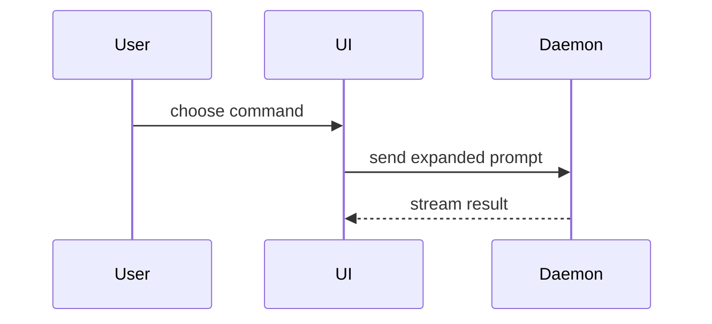

## Title

The title is the commit that lands on the base branch, so in a repository with release-please it is
also the changelog line of the next release: only the types named in `changelog-sections` raise the
version (`feat`, `fix`, `refactor` in `msb-calculator-api`). A change a consumer must receive is
`fix` or `feat` even when it looks like packaging — a lockfile bump, a build script, a `dist`
artifact. `chore(dist)` merges and never reaches a release (#15878 п.3). Read `changelog-sections`
in `release-please-config.json`; do not assume the default type list.

`msb-calculator-api` now enforces the rule instead of relying on it (#15930 п.3): its `release-title`
gate takes the list of dist paths from the package's own `dist-contents-check.php`, so a PR that
touches only packaging — `.gitattributes`, `composer.json`, `README.md`, consumer docs — needs a
release type just as a `src/` change does. Check the planned title before pushing, rather than
learning the type list from a red check:

```bash
php scripts/ci/release-title-check.php --pr origin/main '<the title you plan to use>'
```

## Editing the body of an existing PR

`gh pr edit <n> --body-file …` is not a reliable path here: on a repository whose GraphQL surface still
carries classic Projects it fails with `GraphQL: Projects (classic) is being deprecated in favor of the
new Projects experience`, exits 1, and leaves the body untouched (#15834 п.4). Use the REST endpoint:

```bash
python3 -c 'import json,sys; print(json.dumps({"body": open(sys.argv[1]).read()}))' body.md > /tmp/body.json
gh api -X PATCH repos/<owner>/<repo>/pulls/<n> --input /tmp/body.json --jq '.html_url'
```

`--jq '.html_url'` is not cosmetic: without it the call prints the whole PR object (19 989 bytes in one
line of the #16027 log — 5 % of that session's tool output, spent on confirming «ok»). The link on one line is what
the chat needs anyway (#16046 п.3).

The same for creation — output into a file, the link into the chat:

```bash
gh pr create --base <base> --title '<title>' --body-file body.md > /tmp/pr-create-<n>.txt 2>&1
tail -1 /tmp/pr-create-<n>.txt   # URL; the rest of the output is progress you do not need in context
```

`gh pr edit --add-label` / `--remove-label` work — it is the body edit that breaks.

Use this template for writing the PR body:

```markdown
## Summary

<diagram, diff-sketch, or tree>

## Evidence

- **Before:** <screenshot/output/failing test run>
  **After:** <screenshot/output/passing test run>

## Merge Danger

**Door:** <one-way or two-way>

<optional: description>

**Blast Radius:** <one-word description>

<optional: potential ramifications of merge>
```

## Sections

Skip all preambles and keep prose brief. Use the user's domain language from `GLOSSARY.md`.

### Summary

Pick the smallest view that makes the key point clear.

- Show logic or an algorithm as pseudocode:

```text
on(save)
  if content is unchanged
    return cached result
  write new content
  return fresh result
```

- Show runtime control flow as a call tree:

```text
submitForm
  createSession
    persistPrompt
    launchAgent
  navigateToSession
```

- Show UI structure as a component tree, including state and module boundaries that matter:

```text
<SessionPage> (apps/example/src/routes/session.tsx)
  useSessionEvents()
  <SessionToolbar>
    <RunSkillButton> (packages/ui)
```

- Show file responsibility or a broad refactor as a shallow file tree:

```text
src/
├── commands/       # parses user actions
├── sessions/       # owns session state
└── transport/      # sends API requests
```

- Show component interaction, control flow, or data flow with Mermaid:



- Use `diff` when the point is what changes and the surrounding shape already exists. Match the diff shape to the topic.

For a component change:

```diff
 <SessionPage>
   useSessionEvents()
   <SessionToolbar>
+    <RunSkillButton />
   <SessionTimeline>
+    <SkillResultCard />
```

For a file-layout change:

```diff
 src/
 ├── commands/
+│   └── show-me.ts       # expands the slash command
 ├── sessions/
-└── transport.ts
+└── transport/
+    ├── client.ts
+    └── stream.ts
```

For a call-tree or call-stack change:

```diff
 submitForm
   createSession
     persistPrompt
+    expandSkillMention
     launchAgent
-  navigateToSession
+  navigateToSession
+    subscribeToEvents
```

For a state or control-flow change:

```diff
 on(save)
-  write content
+  if content is unchanged
+    return cached result
+  write new content
+  invalidate cache
```

- Show the whole block when most of it is new, when omitted context would hide ownership or order, or when the user needs a copyable target shape:

```ts
function expandSkill(command: string): string {
  const skillName = command.slice(1);
  return `use the ${skillName} skill`;
}
```

#### Guidance

Place each visual next to the short text it supports. Keep only the calls, files, props, states, and boundaries needed to answer the user's current question or the options to resolve the current discussion point.

You may use one of these, you may use several, it is unlikely you will use all of them. Use your judgement and don't overwhelm the user.

### Evidence

Concrete evidence that the change works. Show a before and after.

Screenshots are S-tier - when the environment is set up for it and the change is visual.

Execution-based evidence is A-tier. Test results, console output. Show the exact test that now fails and passes, using pseudocode.

### Merge Danger

Describe whether it's a one-way or two-way door. You can walk back through two-way doors, but not one-way doors. A PR that is cheap to roll back is lower risk. Changes that involve destructive actions or hard-to-reverse decisions are one-way doors.

The blast radius is the potential impact or scope of the changes introduced by this PR. Consider all possibilities. Examples are layout shift, breakages for consumers, mobile responsiveness, etc.
